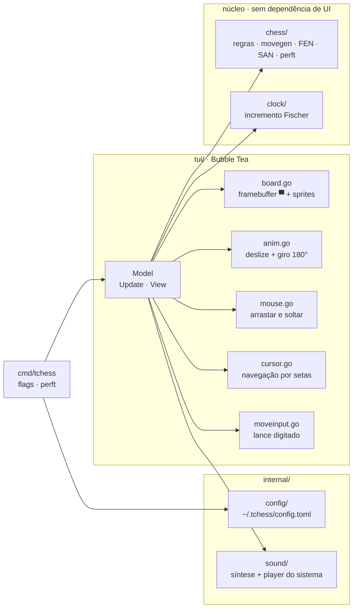

<div align="center">

# ♞ TChess

Xadrez para dois jogadores no terminal, escrito em Go.<br>
As peças são pixel art, dá para arrastá-las com o mouse, o tabuleiro gira para quem vai jogar<br>
e todas as regras da FIDE valem, de en passant à regra dos 75 lances.

[Instalação](#instalação) ·
[Como jogar](#como-jogar) ·
[Como funciona](#como-funciona) ·
[Correção e desempenho](#correção-e-desempenho) ·
[Desenvolvimento](#desenvolvimento)

<br>


</div>

## O que tem

- Regras completas: roque (que não pode passar por casa atacada), en passant (inclusive quando ele descobriria um xeque na horizontal), promoção com escolha da peça, cravadas, xeque duplo, mate e afogamento.
- Todos os jeitos de uma partida terminar. Material insuficiente, repetição quíntupla e a regra dos 75 lances encerram sozinhos. Repetição tripla e a regra dos 50 lances podem ser reivindicadas. Também há acordo, desistência e queda de seta.
- Peças desenhadas com meios-blocos `▀`, em três tamanhos que acompanham o tamanho do terminal.
- Mouse: arraste a peça até a casa, ou clique na origem e depois no destino. Os lances legais aparecem como pontos e as capturas como cantos marcados.
- Teclado: as setas param só onde existe lance possível, ou seja, nas suas peças que podem andar ou nos destinos da peça selecionada.
- Também dá para digitar o lance depois de `:`, em SAN ou em coordenadas (`Nf3`, `exd5`, `O-O`, `e2e4`). Enquanto você digita, as peças que o texto pode indicar acendem no tabuleiro.
- Depois de cada lance a peça desliza e o tabuleiro gira 180°. Qualquer tecla pula a animação, e o relógio do adversário só começa quando ela acaba.
- Relógio com incremento Fischer (bullet, blitz, rápida ou um tempo à sua escolha) e o tempo gasto em cada lance, com barras no histórico.
- Ao lado de cada jogador ficam as peças que ele já capturou e a vantagem de material.
- Seis temas de tabuleiro trocados com `s`, sons para lance, captura, xeque, roque, promoção e fim de partida, e uma ajuda com todos os atalhos no `?`. O tema e o som ficam salvos para a próxima vez.
- Por baixo há um motor de bitboards que gera lances sem alocar memória e passa de 160 milhões de posições por segundo no perft.

<div align="center">
  
  <br>
  <sub>Ataque Møller depois de <code>12...Bxg5</code>, com o cavalo de f3 selecionado e <code>Nxg5</code> marcado como captura.</sub>
</div>

## Instalação

Com Go 1.27 ou mais recente:

```sh
go install github.com/almeidazs/chess/cmd/tchess@latest
```

Há binários para Linux, macOS e Windows (amd64 e arm64) na página de [releases](https://github.com/almeidazs/chess/releases).

Para compilar a partir do código:

```sh
git clone https://github.com/almeidazs/chess.git
cd chess
make run
```

O jogo precisa de um terminal com truecolor e mouse, como Kitty, WezTerm, Ghostty, Alacritty, GNOME Terminal, iTerm2 ou Windows Terminal. Quanto maior a janela, maiores as peças.

## Como jogar

```sh
tchess                  # abre o menu de controle de tempo
tchess --time 5+3       # começa direto: 5 minutos + 3 segundos por lance
tchess --time none      # sem relógio
tchess --theme Oceano   # outro tema só nesta execução
tchess --no-sound       # sem som só nesta execução
tchess perft 6          # autoteste do gerador de lances
tchess --version
```

| Ação | Mouse | Teclado |
| --- | --- | --- |
| Mover uma peça | arrastar até a casa, ou clicar na origem e no destino | `←↑↓→` ou `hjkl`, depois `enter` |
| Digitar o lance | | `:`, o lance e `enter` |
| Cancelar a seleção | clicar fora ou na mesma peça | `esc` |
| Escolher a promoção | clicar na peça do seletor | `↑↓` e `enter`, ou `q` `r` `b` `n` |
| Oferecer ou reivindicar empate | | `d` |
| Desistir | | `r` |
| Trocar o tema | | `s` |
| Ligar ou desligar o som | | `m` |
| Ver os atalhos | | `?` |
| Sair | | `q` ou `ctrl+c` |

Quando a posição permite reivindicar empate por repetição tripla ou pela regra dos 50 lances, a barra de status avisa, e `d` faz a reivindicação. Fora desses casos, `d` oferece empate e o adversário responde com `y` ou `n`.

O campo do `:` aceita o lance escrito de vários jeitos: `Nf3`, `nf3`, `Ngf3`, `g1f3` ou `g1-f3`, roque como `O-O` ou `0-0`, captura com ou sem `x` e promoção como `e8=Q`, `e8Q` ou `e7e8q`. Sinais como `+`, `#`, `!` e `?` são ignorados. Se o texto serve para dois lances (`Nd2` com os dois cavalos podendo ir), o jogo pede para desfazer a ambiguidade. Escrever só `e8` abre o seletor de promoção. Em `bc3` com letra minúscula, que pode ser peão ou bispo, vale o peão, como na maioria dos aplicativos.

O tamanho das peças depende do terminal:

| Terminal | Peças |
| --- | --- |
| a partir de 122×46 | 11×10 pixels |
| a partir de 106×38 | 9×8 pixels |
| a partir de 90×30 | 7×6 pixels |
| a partir de 58×14 | um caractere Unicode por casa |

### Preferências

O tema, o som e o último controle de tempo jogado ficam em `~/.tchess/config.toml`, que o jogo grava sozinho quando algo muda. O menu já abre no último ritmo. As flags `--theme` e `--no-sound` valem só para aquela execução e não mudam o arquivo.

```toml
theme = "Floresta"
sound = true
time_control = "5+3"
```

Os temas são Madeira, Floresta, Oceano, Grafite, Coral e Mármore. Os sons são gerados pelo próprio programa e tocados pelo player do sistema: `pw-play`, `paplay` ou `aplay` no Linux, `afplay` no macOS e PowerShell no Windows. Os arquivos WAV ficam em `~/.tchess/sounds/`. Sem nenhum desses players, o jogo roda mudo.

## Como funciona



O pacote `chess` é o motor de regras, o `clock` é o relógio e o `tui` é a interface. A interface usa o motor por uma API pequena (`Game.Play`, `Game.MovesFrom`, `Game.ClaimDraw` e poucas outras). O motor devolve só enums, e todo texto que aparece na tela mora na interface.

<details>
<summary><b>O motor: bitboards e lances legais</b></summary>

<br>

Cada tipo de peça de cada cor é guardado num `uint64`, com um bit por casa (`A1` é o bit 0). Ao lado fica um *mailbox* de 64 casas, sempre sincronizado, para responder em O(1) qual peça está em cada casa. Um lance cabe em 16 bits: 6 para a origem, 6 para o destino e 4 de flags (captura, promoção, roque, en passant e avanço duplo).

Os ataques de bispos e torres usam magic bitboards. As casas relevantes (`mask`) são multiplicadas por um número escolhido e deslocadas, e o resultado vira o índice de uma tabela de ataques pré-calculada:

```go
func (m *magic) attacks(occ Bitboard) Bitboard {
	return m.table[(uint64(occ&m.mask)*m.mul)>>m.shift]
}
```

Esses números são procurados na inicialização, com um gerador determinístico, e a busca leva poucos milissegundos.

O gerador produz direto só os lances legais, sem jogar cada lance para testar se o rei ficou em xeque:

- O rei só vai para casas que o adversário não ataca. Esses ataques são calculados com o rei fora do tabuleiro, para ele não recuar ao longo da linha do próprio xeque.
- Em xeque duplo, só o rei se move.
- Em xeque simples, as outras peças precisam capturar quem dá o xeque ou bloquear a linha. Isso é feito com uma máscara de xeque.
- Peças cravadas só andam sobre a linha da cravada.
- O en passant tira duas peças da mesma fileira de uma vez, então passa por um teste exato de xeque descoberto.

Jogar e desfazer um lance atualiza bitboards, mailbox e hash Zobrist de forma incremental, em cerca de 19 ns pelo par. O hash serve para reconhecer posições repetidas. Como manda a FIDE, a casa de en passant só entra no hash quando a captura é legal de verdade.

</details>

<details>
<summary><b>A interface: pixels num terminal</b></summary>

<br>

O caractere `▀` pinta a metade de cima da célula com a cor da frente e a metade de baixo com a cor de fundo. Com isso, cada célula do terminal mostra dois pixels independentes e quase quadrados:

```
uma célula            dois pixels
┌─────────┐           ┌─────────┐
│    ▀    │  fg  →    │█████████│  pixel de cima
│         │  bg  →    │▒▒▒▒▒▒▒▒▒│  pixel de baixo
└─────────┘           └─────────┘
```

O tabuleiro é desenhado primeiro num framebuffer de pixels (casas, destaques, pontos de lance, brilho do xeque e sprites) e depois convertido em texto. Os códigos de cor só são emitidos quando a cor muda, e um quadro inteiro sai em cerca de 0,4 ms. Esse framebuffer é genérico e fica no pacote `internal/pixel`.

As peças são pixel art escrita no próprio código. A largura ímpar dá a cada peça uma coluna central e um pixel de margem de cada lado:

```text
...........      .  transparente
....###....      #  contorno
...#ooo#...      o  corpo
...#ooo#...      x  detalhe
....###....
...#ooo#...
....#o#....
...#ooo#...
..#ooooo#..
.#########.
```

Como o tabuleiro fica igual depois de uma rotação de 180°, as casas não precisam se mexer na animação: só as peças giram em volta do centro. No meio do giro as posições encolhem um pouco (`1 − 0,3·sen θ`) para os cantos não saírem do tabuleiro, e as peças mais baixas são desenhadas por cima das outras, o que dá uma ideia de profundidade.

A posição de cada elemento na tela é uma função pura do tamanho do terminal. Por isso o clique do mouse usa a mesma geometria do desenho, inclusive com o tabuleiro virado.

</details>

<details>
<summary><b>Relógio e tempo por lance</b></summary>

<br>

O relógio (`clock/`) implementa incremento Fischer e recebe a fonte de tempo de fora, o que deixa os testes determinísticos. O tempo do adversário só começa a correr quando a animação de giro termina, para ninguém perder segundos vendo o tabuleiro virar. A mesma regra vale para o tempo de cada lance que aparece no histórico.

</details>

<details>
<summary><b>Som sem cgo</b></summary>

<br>

Tocar áudio direto do processo em Go exige cgo e ALSA no Linux, o que impediria os binários estáticos para todas as plataformas. Por isso o pacote `internal/sound` sintetiza cada efeito em código, com senoides com envelope e ruído filtrado: o "toc" de madeira de um lance, um impacto mais grave na captura, dois toques no roque, um sino no xeque, um arpejo na promoção e um acorde no fim da partida. O resultado vira WAV de 16 bits, é gravado uma vez em `~/.tchess/sounds/` e tocado por um processo do player do sistema, sem bloquear a interface.

</details>

## Correção e desempenho

O gerador de lances é conferido com perft, que conta todas as posições alcançáveis até uma profundidade e compara com os valores publicados no [Chessprogramming Wiki](https://www.chessprogramming.org/Perft_Results). Um erro em qualquer regra muda a contagem.

| Posição | Profundidade | Nós | Tempo¹ |
| --- | :---: | ---: | ---: |
| Inicial | 6 | 119.060.324 | 0,73 s |
| Kiwipete | 5 | 193.690.690 | 0,80 s |
| Posições 3 a 6 do wiki | 4 e 5 | conferidas no `go test` | |

| Benchmark¹ | Resultado |
| --- | ---: |
| Perft da posição inicial | cerca de 163 milhões de nós/s |
| Gerar os lances legais do Kiwipete (48 lances) | 126 ns, sem alocação |
| Jogar e desfazer um lance | 19 ns, sem alocação |
| Desenhar um quadro da interface | cerca de 0,4 ms |

<sub>¹ Intel Core i7-13620H, Go 1.27, uma thread. Dá para repetir com <code>make bench</code> e <code>make perft</code>.</sub>

Os testes também cobrem cada regra separadamente (en passant, roque, cravadas, promoção, SAN, empates e queda de seta), o relógio e a interface, com cliques e arrastos no tabuleiro virado, navegação pelo teclado, promoção, animações e o desenho em todos os tamanhos de tela. O campo de lance digitado, a troca de tema, a gravação da config e a escolha de cada som também têm testes, que não tocam áudio de verdade.

## Desenvolvimento

`make help` lista os comandos:

| Comando | O que faz |
| --- | --- |
| `make build` | compila em `bin/tchess` |
| `make run` | compila e abre o jogo |
| `make test` | roda os testes com o detector de race |
| `make test-short` | roda os testes com perft mais raso |
| `make bench` | benchmarks do motor e da interface |
| `make perft` | perft(6) da posição inicial |
| `make cover` | resumo de cobertura |
| `make lint`, `make fmt` | [golangci-lint](https://golangci-lint.run) com a configuração do repositório |
| `make assets` | gera de novo o print e o GIF deste README |
| `make snapshot` | gera os pacotes de release localmente com [GoReleaser](https://goreleaser.com) |

As imagens deste README saem de [`tools/shot`](tools/shot). Ele controla a interface de verdade (teclas, cliques e arrastos) com um relógio falso e transforma a saída ANSI de cada quadro em imagem, então print e GIF sempre batem com o código.

```
.
├── chess/                 motor de regras (sem UI)
│   ├── types.go           Color, PieceType, Piece
│   ├── square.go          Square e coordenadas
│   ├── bitboard.go        Bitboard e máscaras
│   ├── move.go            Move (16 bits) e flags · movelist.go: buffer sem alocação
│   ├── castling.go        direitos de roque
│   ├── position.go        Position: estado e consultas de ataque
│   ├── makemove.go        Make / Unmake incrementais
│   ├── attacks.go         tabelas de ataque · magic.go: magic bitboards
│   ├── movegen.go         gerador de lances legais
│   ├── material.go        valores, material insuficiente
│   ├── zobrist.go         hash de posição
│   ├── fen.go · san.go    notações
│   ├── game.go            Game: histórico e lances
│   ├── gameover.go        mate, empates, repetição, desistência, queda de seta
│   ├── outcome.go         Outcome e Termination · errors.go
│   └── perft.go           contagem de nós
├── clock/                 TimeControl (timecontrol.go) e Clock (clock.go)
├── internal/
│   ├── pixel/             framebuffer de meios-blocos ▀, genérico
│   ├── config/            leitura e gravação de ~/.tchess/config.toml
│   └── sound/             síntese dos efeitos (synth.go) e player do sistema (player.go)
├── tui/                   interface Bubble Tea
│   ├── types.go           tipos de estado · messages.go: mensagens e ticks
│   ├── model.go           Model, Init, Update
│   ├── game.go            fluxo da partida · keyboard.go · mouse.go · cursor.go · selection.go
│   ├── moveinput.go       lance digitado: leitura tolerante e destaque ao vivo
│   ├── prefs.go           tema, som e gravação das preferências · help.go: a ajuda do ?
│   ├── layout.go          geometria adaptativa · coords.go: casa ↔ tela
│   ├── view.go            composição da tela · status.go · panel.go · format.go
│   ├── board.go           aparência das casas · board_pixel.go · board_glyph.go
│   ├── anim.go            deslize e giro do tabuleiro
│   ├── sprites.go         desenho dos sprites · sprite_data.go: a pixel art
│   ├── theme.go           os seis temas e os estilos · glyphs.go · text.go (textos em português)
│   └── menu.go            menu de controle de tempo
├── cmd/tchess/            binário (main.go, perft.go)
├── tools/shot/            gerador das imagens do README (módulo separado)
└── assets/                print e GIF gerados
```

Cada pacote tem um `doc.go` com a sua documentação. Tipos do domínio ficam em arquivos com o nome do tipo (`square.go`, `move.go`), e os tipos de estado da interface ficam juntos em `tui/types.go`. O comportamento de cada recurso fica no arquivo dele, e os testes seguem a mesma divisão (`movegen_test.go`, `drag_test.go`, `panel_test.go`).

## Licença

Distribuído sob a [Licença Apache 2.0](LICENSE). Copyright 2026 Almeida.

<div align="center">
<sub>Feito com <a href="https://github.com/charmbracelet/bubbletea">Bubble Tea</a> e <a href="https://github.com/charmbracelet/lipgloss">Lip Gloss</a>.</sub>
</div>
