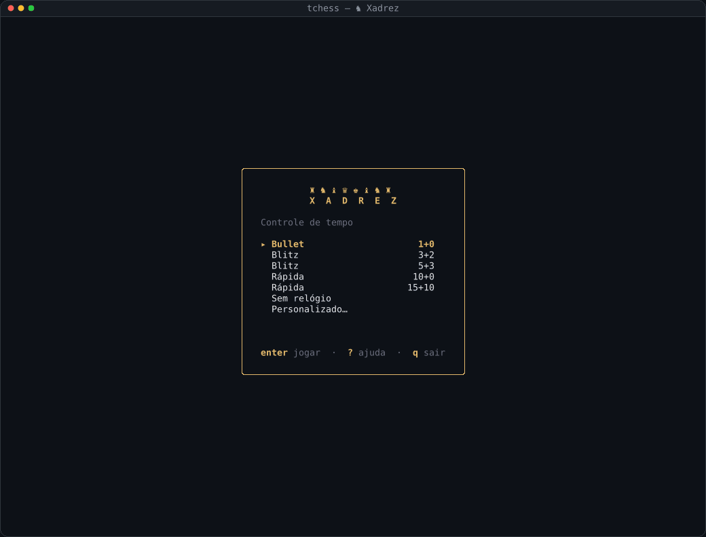
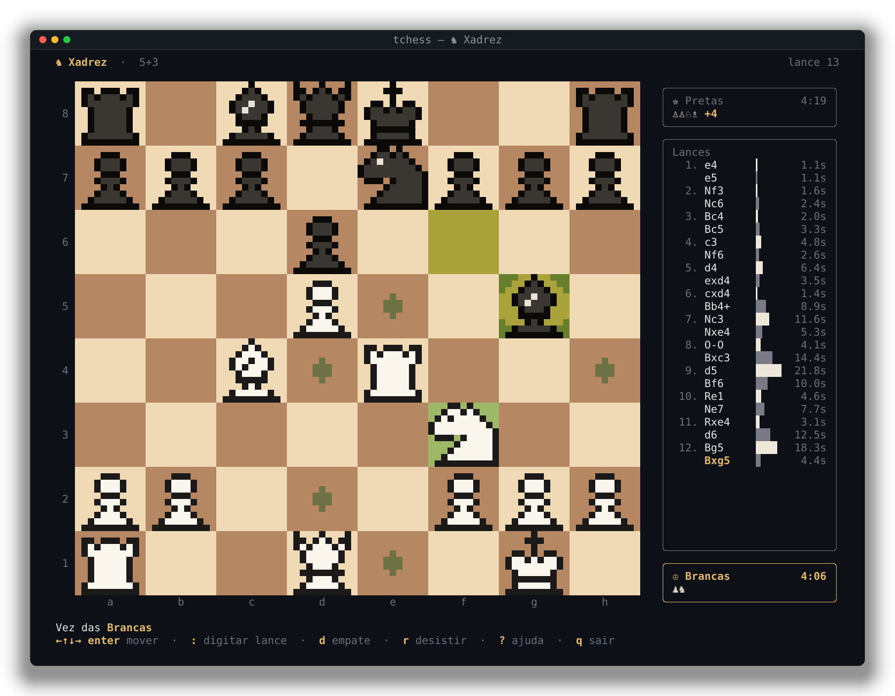
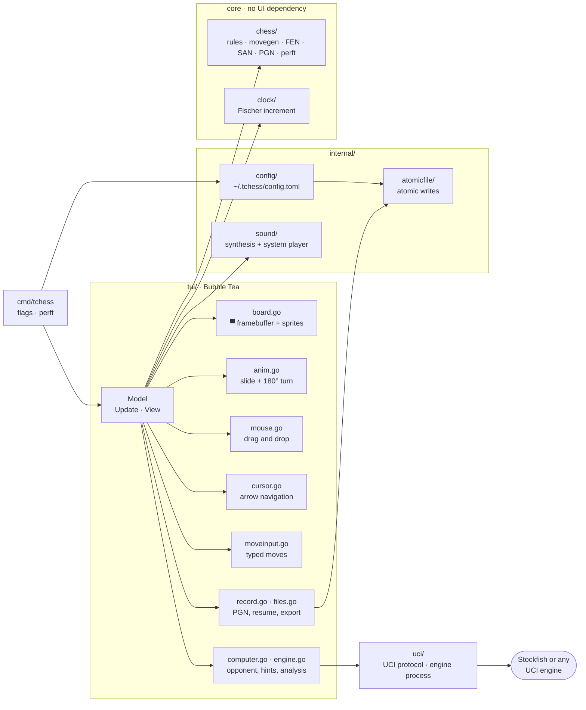

<div align="center">

# ♞ TChess

Chess in the terminal, written in Go: two players on one keyboard or you against Stockfish.<br>
The pieces are pixel art, you can drag them with the mouse, the board turns to face whoever moves next<br>
and every FIDE rule applies, from en passant to the 75-move rule.

[Install](#install) ·
[How to play](#how-to-play) ·
[How it works](#how-it-works) ·
[Correctness and speed](#correctness-and-speed) ·
[Development](#development)

<br>



</div>

## Features

- Complete rules: castling (which can't pass through an attacked square), en passant (including when it would uncover a horizontal check), promotion with a choice of piece, pins, double check, checkmate and stalemate.
- Every way a game can end. Insufficient material, fivefold repetition and the 75-move rule end it on their own. Threefold repetition and the 50-move rule can be claimed. There's also agreement, resignation and flag fall.
- Pieces drawn with `▀` half blocks, in three sizes that follow the size of the terminal.
- Mouse: drag a piece to its square, or click the piece and then the destination. Legal moves show as dots and captures as marked corners.
- Keyboard: the arrows only stop where a move is possible, that is, on your pieces that can move or on the destinations of the selected piece.
- You can also type the move after `:`, in SAN or coordinates (`Nf3`, `exd5`, `O-O`, `e2e4`). As you type, the pieces the text could mean light up on the board.
- After each move the piece slides and the board turns 180°. Any key skips the animation, and the opponent's clock only starts once it ends. If you'd rather always see the board from White's side, turn rotation off in the menu or with `f`.
- Fischer-increment clock (bullet, blitz, rapid or a time of your choice) and the time spent on each move, with bars in the move list.
- Next to each player are the pieces they captured and their material advantage.
- You can take back moves if the opponent agrees, and review any earlier position with `[` and `]` or by clicking the move list, without stopping the clock.
- The game in progress is saved on its own. If you close the terminal, the menu offers to continue where you left off, with the clocks as they were.
- Every finished game is saved as PGN, with the time of each move in the `[%clk]` and `[%emt]` comments Lichess reads. You can open any of them again from the menu, or import a PGN from another program.
- Play the computer through any UCI engine, such as Stockfish, from Beginner (~800) to full strength or at an Elo you pick, with hints and take-backs. When you review a game, the engine shows an evaluation bar.
- Six board themes, picked in the menu with a preview of the board or switched with `s` during a game. Sounds for moves, captures, check, castling, promotion and the end of the game, and a help card with every shortcut on `?`. All of it is remembered for next time.
- Underneath is a bitboard engine that generates moves without allocating memory and goes past 160 million positions per second in perft.

<div align="center">
  
  <br>
  <sub>Møller Attack after <code>12...Bxg5</code>, with the f3 knight selected and <code>Nxg5</code> marked as a capture.</sub>
</div>

## Install

With Go 1.27 or newer:

```sh
go install github.com/almeidazs/tchess/cmd/tchess@latest
```

With Docker, without installing anything (the volume keeps your preferences and games):

```sh
docker run --rm -it -v tchess:/root/.tchess ghcr.io/almeidazs/tchess
```

The [releases](https://github.com/almeidazs/tchess/releases) page has binaries for Linux, macOS and Windows (amd64 and arm64) and `.deb`, `.rpm`, `.apk` and `.pkg.tar.zst` packages:

```sh
sudo apt install ./tchess_*_amd64.deb           # Debian, Ubuntu
sudo dnf install ./tchess-*.x86_64.rpm          # Fedora
sudo apk add --allow-untrusted ./tchess_*.apk   # Alpine
sudo pacman -U ./tchess-*.pkg.tar.zst           # Arch
```

To play the computer, also install a UCI engine. tchess looks for Stockfish on its own:

```sh
sudo apt install stockfish    # Debian, Ubuntu (dnf on Fedora, brew on macOS)
```

To build from source:

```sh
git clone https://github.com/almeidazs/tchess.git
cd tchess
make run
```

The game needs a terminal with truecolor and mouse support, such as Kitty, WezTerm, Ghostty, Alacritty, GNOME Terminal, iTerm2 or Windows Terminal. The bigger the window, the bigger the pieces.

## How to play

```sh
tchess                  # open the menu
tchess --time 5+3       # start right away: 5 minutes + 3 seconds per move
tchess --time none      # no clock
tchess --pgn game.pgn   # open a game from a PGN file
tchess --computer hard  # play the computer (a level or an Elo, e.g. 1750)
tchess --color black    # your side against the computer (white, black, random)
tchess --engine /path   # use another UCI engine
tchess --theme Ocean    # another theme for this run only
tchess --no-sound       # no sound for this run only
tchess perft 6          # move generator self-test
tchess --version
```

| Action | Mouse | Keyboard |
| --- | --- | --- |
| Move a piece | drag it to the square, or click the piece and the destination | `←↑↓→` or `hjkl`, then `enter` |
| Type a move | | `:`, the move and `enter` |
| Cancel the selection | click elsewhere or on the same piece | `esc` |
| Choose the promotion | click the piece in the picker | `↑↓` and `enter`, or `q` `r` `b` `n` |
| Ask to take back a move | | `u` (the opponent answers `y` or `n`); while reviewing, back to the position shown |
| Review earlier moves | click a move in the move list | `[` and `]` (at the end of a game, also `←` and `→`), `home` and `end`, `esc` goes back |
| Hide or show the result | | `esc` at the end of a game |
| Ask the computer for a hint | | `t` |
| Export the game as PGN | | `e` |
| Offer or claim a draw | | `d` |
| Resign | | `r` |
| Switch theme | | `s` |
| Sound on or off | | `m` |
| Board rotation on or off | | `f` |
| Show the shortcuts | | `?` |
| Quit | | `q` or `ctrl+c` |

When the position allows claiming a draw by threefold repetition or the 50-move rule, the status bar says so and `d` makes the claim. Otherwise, `d` offers a draw and the opponent answers `y` or `n`.

The menu has the time controls and, below them, the options: the theme (which opens the list with a board preview for each one), board rotation and "Open PGN". When there's an interrupted game, the first entry is "Continue".

A take-back is asked by whoever just moved, and the opponent decides. To go further back, review the position you want and press `u`: the request is to take the game back to there, made by the side to move in that position. The requester's clock goes back to what it showed at the moment of the move, without the increment that move earned, and the opponent's goes back to what it showed before it started running. While reviewing, the board shows the chosen position, the clock keeps running and you can only play again after returning to the present.

The `:` prompt accepts a move written in many ways: `Nf3`, `nf3`, `Ngf3`, `g1f3` or `g1-f3`, castling as `O-O` or `0-0`, captures with or without `x` and promotion as `e8=Q`, `e8Q` or `e7e8q`. Marks like `+`, `#`, `!` and `?` are ignored. If the text fits two moves (`Nd2` with both knights able to go there), the game asks you to disambiguate. Typing just `e8` opens the promotion picker. A lowercase `bc3`, which could be a pawn or a bishop, means the pawn, as in most chess apps.

The size of the pieces depends on the terminal:

| Terminal | Pieces |
| --- | --- |
| 122×46 or larger | 11×10 pixels |
| 106×38 or larger | 9×8 pixels |
| 90×30 or larger | 7×6 pixels |
| 58×14 or larger | one Unicode character per square |

### Playing the computer

The first entry in the menu is the opponent. Choosing "Computer" asks for the level and your color:

| Level | Strength |
| --- | --- |
| Beginner | about 800 |
| Easy | about 1200 |
| Medium | about 1600 |
| Hard | about 2000 |
| Expert | about 2400 |
| Max | the engine's full strength |
| Custom Elo… | any Elo from 400 to 3500 |

tchess talks to the engine through UCI, so any UCI engine works; it looks for `stockfish` on the PATH (and in `/usr/games`, where Debian puts it). With Stockfish, levels from 1320 Elo up use its own `UCI_Elo` setting, and the weaker ones use `Skill Level` with a shallow search. Without an engine, the menu explains how to install one and the rest of the game works as usual.

The computer plays with the real clock: it gets both clocks and the increment and manages its own time, while the lower levels also answer within a short thinking time. Without a clock, each level thinks for a fixed time per move. The board stays on your side.

Against the computer, `u` takes back your last move and its reply right away, and `t` highlights the engine's best move. Games where you used either are marked in the PGN. When you offer a draw, the computer takes a quick look and accepts if it isn't better; it never offers a draw or resigns itself. A game against the computer can be resumed like any other, against the same level.

With an engine available, reviewing any game (against the computer, between two people or opened from a PGN) and the end of a game show an evaluation bar next to the board and the score (`+1.2`, `M3`) in the status bar. While a game is being played, the evaluation stays hidden.

### Preferences

The theme, sound, board rotation, the opponent and the last time control you played are kept in `~/.tchess/config.toml`, which the game writes whenever something changes. The menu opens on the last time control. The `--theme`, `--no-sound`, `--computer`, `--color` and `--engine` flags only apply to that run and don't change the file.

```toml
theme = "Forest"
sound = true
flip = true
time_control = "5+3"
engine = ""            # empty: Stockfish from the PATH
opponent = "computer"  # or "human"
computer_elo = 1600    # 0: full strength
human_color = "white"  # or "black", "random"
```

The themes are Wood, Forest, Ocean, Graphite, Coral and Marble. The sounds are generated by the program itself and played by the system's audio player: `pw-play`, `paplay` or `aplay` on Linux, `afplay` on macOS and PowerShell on Windows. The WAV files live in `~/.tchess/sounds/`. Without any of those players, the game runs silently.

### Saved games and PGN

The game in progress is written to `~/.tchess/current.pgn` after every move, so it can be resumed. When you continue it, the clock of the side to move starts running right away. Starting another game discards it.

Every game that ends (checkmate, resignation, draw or time) goes to `~/.tchess/games/` on its own, in a file named after the date and time, and leaves `current.pgn`. Mid-game, `e` saves a copy to the same folder. Each move carries the clock after it (`[%clk 0:04:58.0]`) and the time spent (`[%emt 0:00:04.2]`), so the file can be imported straight into Lichess. "Open PGN" in the menu lists that folder and accepts any other path; `--pgn` does the same from the command line. A file with several games, such as a Lichess export or a tournament, shows a list of them with the players, the result and the number of moves, and games that can't be read are skipped with a notice. The reader accepts what other programs write: comments, variations (which are skipped), NAGs, a starting position given by FEN and moves in SAN or coordinates.

A finished game opens on its final position, with the result and the reason in the status bar, and the arrows step through the moves. An unfinished one first asks how to continue: with the PGN's own clocks, when it has `[%clk]`, with one of the menu's time controls (both clocks full) or without a clock.

## How it works



The `chess` package is the rules engine, `clock` is the clock, `uci` talks to an external engine and `tui` is the interface. The interface uses the engine through a small API (`Game.Play`, `Game.Undo`, `Game.PositionAt`, `Game.PGN`, `ParsePGN` and a few others). The engine only returns enums; every piece of text on screen lives in the interface.

<details>
<summary><b>The engine: bitboards and legal moves</b></summary>

<br>

Each piece type of each color is stored in a `uint64`, one bit per square (`A1` is bit 0). Next to it sits a 64-square *mailbox*, always in sync, to answer in O(1) which piece is on a square. A move fits in 16 bits: 6 for the origin, 6 for the destination and 4 for flags (capture, promotion, castling, en passant and double push).

Bishop and rook attacks use magic bitboards. The relevant squares (`mask`) are multiplied by a chosen number and shifted, and the result indexes a precomputed attack table:

```go
func (m *magic) attacks(occ Bitboard) Bitboard {
	return m.table[(uint64(occ&m.mask)*m.mul)>>m.shift]
}
```

Those numbers are searched for at startup with a deterministic generator, and the search takes a few milliseconds.

The generator produces only legal moves directly, without playing each move to check whether the king was left in check:

- The king only goes to squares the opponent doesn't attack. Those attacks are computed with the king off the board, so it can't retreat along the line of its own check.
- In double check, only the king moves.
- In single check, the other pieces must capture the checker or block the line. A check mask handles this.
- Pinned pieces only move along the pin line.
- En passant removes two pieces from the same rank at once, so it goes through an exact discovered-check test.

Making and unmaking a move updates the bitboards, the mailbox and the Zobrist hash incrementally, in about 19 ns for the pair. The hash is used to recognize repeated positions. As FIDE requires, the en passant square only enters the hash when the capture is actually legal.

</details>

<details>
<summary><b>The interface: pixels in a terminal</b></summary>

<br>

The `▀` character paints the top half of a cell with the foreground color and the bottom half with the background color. That way, every terminal cell shows two independent, nearly square pixels:

```
one cell              two pixels
┌─────────┐           ┌─────────┐
│    ▀    │  fg  →    │█████████│  top pixel
│         │  bg  →    │▒▒▒▒▒▒▒▒▒│  bottom pixel
└─────────┘           └─────────┘
```

The board is first drawn into a pixel framebuffer (squares, highlights, move dots, the check glow and sprites) and then turned into text. Color codes are only emitted when the color changes, and a whole frame takes about 0.4 ms. The framebuffer is generic and lives in the `internal/pixel` package.

The pieces are pixel art written in the code itself. The odd width gives each piece a center column and one pixel of margin on each side:

```text
...........      .  transparent
....###....      #  outline
...#ooo#...      o  body
...#ooo#...      x  detail
....###....
...#ooo#...
....#o#....
...#ooo#...
..#ooooo#..
.#########.
```

Since the board looks the same after a 180° rotation, the squares don't need to move during the animation: only the pieces turn around the center. Mid-turn the positions shrink a little (`1 − 0.3·sin θ`) so the corners stay on the board, and lower pieces are drawn over the others, which gives a sense of depth.

Where each element sits on screen is a pure function of the terminal size. That's why mouse clicks use the same geometry as the drawing, even with the board turned.

</details>

<details>
<summary><b>Clock and move times</b></summary>

<br>

The clock (`clock/`) implements the Fischer increment and receives its time source from outside, which keeps the tests deterministic. The opponent's time only starts running once the turn animation ends, so nobody loses seconds watching the board turn. The same rule applies to the time of each move shown in the move list.

</details>

<details>
<summary><b>Talking to the engine</b></summary>

<br>

The `uci` package starts the engine as a process and speaks UCI over its standard input and output: the `uci`/`uciok` handshake, where the engine names itself and lists its options, `setoption` to set the strength, and `position` plus `go` for each search, reading the `info` lines (depth, score, principal variation) until `bestmove`. A search can be stopped at any moment with `stop`.

In the interface, every search runs in the background and starts by canceling the previous one: the computer's move, a hint, a draw decision or the evaluation of a reviewed position. Each result carries the number of its search, so an answer that arrives after the position changed (a take-back, a new game) is recognized and dropped. The engine process starts the first time it's needed and ends with the program.

The tests drive a fake engine written in Go (`uci/ucitest`): the test binary runs itself as the engine, so the protocol and the whole game against the computer are tested without Stockfish installed.

</details>

<details>
<summary><b>Sound without cgo</b></summary>

<br>

Playing audio directly from a Go process needs cgo and ALSA on Linux, which would rule out static binaries for every platform. So the `internal/sound` package synthesizes each effect in code, with enveloped sine waves and filtered noise: the wooden knock of a move, a deeper impact for captures, two knocks for castling, a bell for check, an arpeggio for promotion and a chord at the end of the game. The result becomes a 16-bit WAV, is written once to `~/.tchess/sounds/` and is played by a process of the system's player, without blocking the interface.

</details>

## Correctness and speed

The move generator is checked with perft, which counts every position reachable up to a depth and compares the count with the values published on the [Chessprogramming Wiki](https://www.chessprogramming.org/Perft_Results). A mistake in any rule changes the count.

| Position | Depth | Nodes | Time¹ |
| --- | :---: | ---: | ---: |
| Initial | 6 | 119,060,324 | 0.73 s |
| Kiwipete | 5 | 193,690,690 | 0.80 s |
| Wiki positions 3 to 6 | 4 and 5 | checked in `go test` | |

| Benchmark¹ | Result |
| --- | ---: |
| Perft from the initial position | about 163 million nodes/s |
| Generating Kiwipete's legal moves (48 moves) | 126 ns, no allocation |
| Making and unmaking a move | 19 ns, no allocation |
| Drawing one frame of the interface | about 0.4 ms |

<sub>¹ Intel Core i7-13620H, Go 1.27, one thread. Reproduce with <code>make bench</code> and <code>make perft</code>.</sub>

The tests also cover each rule on its own (en passant, castling, pins, promotion, SAN, PGN, take-backs and draws), the clock and the interface, with clicks and drags on the turned board, keyboard navigation, promotion, animations and drawing at every screen size. Typed moves, take-backs with their clocks, review, exporting, importing and resuming games, the theme and PGN pickers, the config and the choice of each sound are tested too, writing to a temporary folder and never playing real audio. So is the game against the computer, against a fake UCI engine: its moves, levels, hints, draw offers, take-backs, resuming and the evaluation.

## Development

`make help` lists the commands:

| Command | What it does |
| --- | --- |
| `make build` | builds `bin/tchess` |
| `make run` | builds and opens the game |
| `make test` | runs the tests with the race detector |
| `make test-short` | runs the tests with shallower perft |
| `make bench` | engine and interface benchmarks |
| `make perft` | perft(6) from the initial position |
| `make cover` | coverage summary |
| `make lint`, `make fmt` | [golangci-lint](https://golangci-lint.run) with the repository's config |
| `make assets` | regenerates this README's screenshot and GIF |
| `make snapshot` | builds the release packages locally with [GoReleaser](https://goreleaser.com) |

Releases go out with `git tag vX.Y.Z && git push --tags`: GoReleaser builds the binaries, the packages and the Docker image. What changes in each one goes in the [CHANGELOG](CHANGELOG.md). Security issues should be reported as described in [SECURITY](SECURITY.md), and the project follows a [code of conduct](CODE_OF_CONDUCT.md).

The images in this README come from [`tools/shot`](tools/shot). It drives the real interface (keys, clicks and drags) with a fake clock and turns the ANSI output of each frame into an image, so the screenshot and the GIF always match the code.

```
.
├── chess/                 rules engine (no UI)
│   ├── types.go           Color, PieceType, Piece
│   ├── square.go          Square and coordinates
│   ├── bitboard.go        Bitboard and masks
│   ├── move.go            Move (16 bits) and flags · movelist.go: allocation-free buffer
│   ├── castling.go        castling rights
│   ├── position.go        Position: state and attack queries
│   ├── makemove.go        incremental Make / Unmake
│   ├── attacks.go         attack tables · magic.go: magic bitboards
│   ├── movegen.go         legal move generator
│   ├── material.go        piece values, insufficient material
│   ├── zobrist.go         position hashing
│   ├── fen.go · san.go    notations · pgn.go: PGN writing and reading
│   ├── game.go            Game: history, moves, Undo and PositionAt
│   ├── gameover.go        checkmate, draws, repetition, resignation, flag fall
│   ├── outcome.go         Outcome and Termination · errors.go
│   └── perft.go           node counting
├── clock/                 TimeControl (timecontrol.go) and Clock (clock.go)
├── uci/                   UCI engine process and protocol (engine.go) · find.go: locating Stockfish
│   └── ucitest/           fake engine for tests
├── internal/
│   ├── pixel/             generic ▀ half-block framebuffer
│   ├── atomicfile/        atomic writes (temporary file + rename)
│   ├── config/            reading and writing ~/.tchess/config.toml
│   └── sound/             effect synthesis (synth.go) and system player (player.go)
├── tui/                   Bubble Tea interface
│   ├── types.go           state types · messages.go: messages and ticks
│   ├── model.go           Model, Init, Update
│   ├── game.go            game flow · keyboard.go · mouse.go · cursor.go · selection.go
│   ├── moveinput.go       typed moves: lenient reading and live highlights
│   ├── undo.go            asking for and accepting take-backs · review.go: earlier positions
│   ├── record.go          game ↔ PGN with clocks · files.go: resume, export, list · export.go
│   ├── prefs.go           theme, sound, rotation and saving preferences · help.go: the ? card
│   ├── layout.go          adaptive geometry · coords.go: square ↔ screen
│   ├── view.go            screen composition · status.go · panel.go · format.go
│   ├── board.go           square appearance · board_pixel.go · board_glyph.go
│   ├── anim.go            piece slide and board turn
│   ├── sprites.go         sprite drawing · sprite_data.go: the pixel art
│   ├── theme.go           the six themes and the styles · glyphs.go · text.go (all UI text)
│   ├── menu.go            menu: continue, time controls and options
│   ├── themes.go          theme picker with a board preview
│   ├── openpgn.go         PGN file picker and the list of a file's games
│   ├── clocks.go          time control for continuing an imported game
│   ├── computer.go        the computer opponent, hints, draw offers, evaluation
│   ├── engine.go          background searches · strength.go: levels and UCI options
│   ├── opponents.go       opponent, level and color picker
│   └── evalbar.go         evaluation bar
├── cmd/tchess/            the binary (main.go, perft.go)
├── tools/shot/            README image generator (separate module)
└── assets/                generated screenshot and GIF
```

Each package has a `doc.go` with its documentation. Domain types live in files named after the type (`square.go`, `move.go`), and the interface's state types are grouped in `tui/types.go`. Each feature's behavior lives in its own file, and the tests follow the same split (`movegen_test.go`, `drag_test.go`, `panel_test.go`).

## License

Released under the [Apache License 2.0](LICENSE). Copyright 2026 Almeida.
